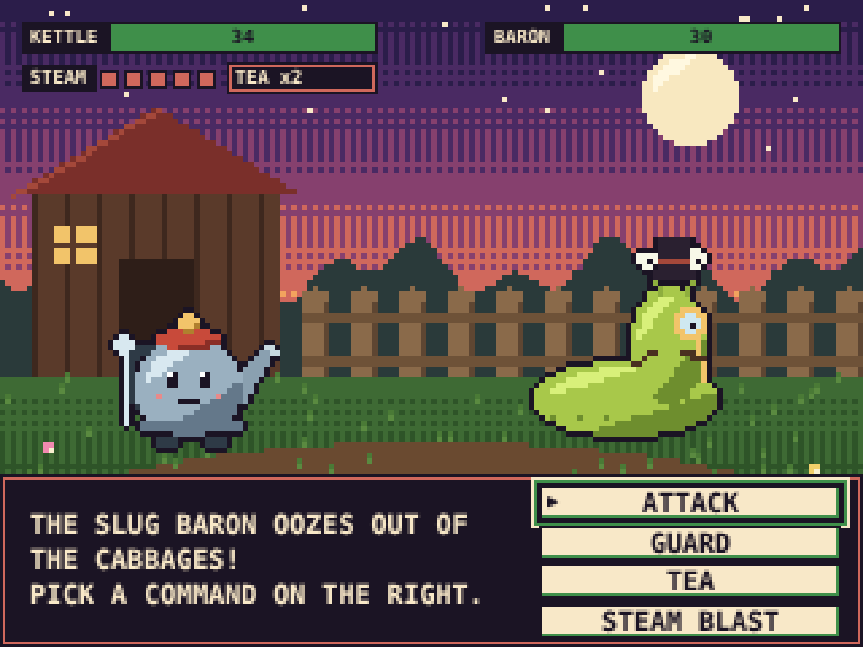
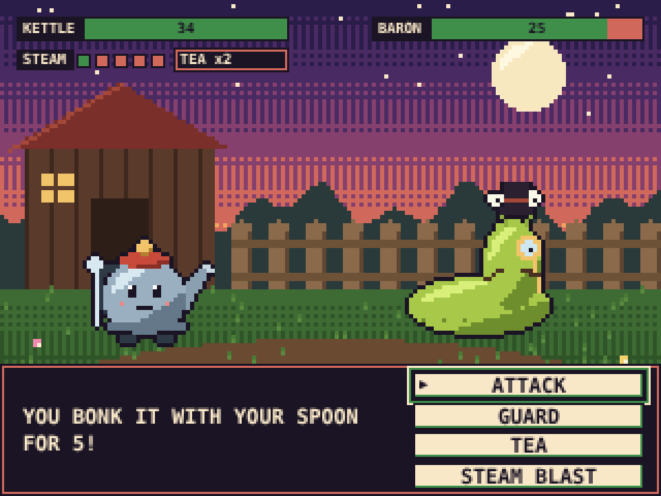
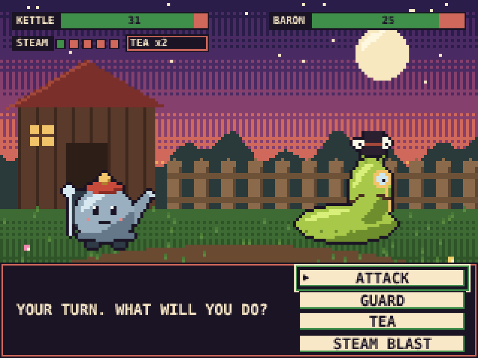
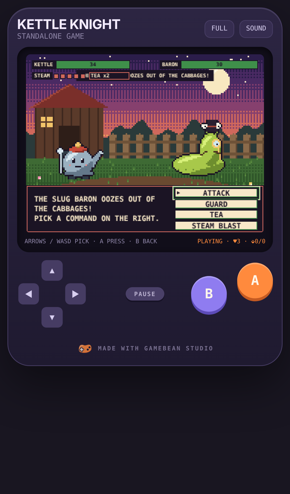

# Kettle Knight

A turn-based battle game made with [GameBean Studio](https://github.com/icakinser/gamebean-studio). A brave tin kettle guards the garden shed from three pests: the Slug Baron, the Wasp Duchess and Old Rootmole. Pick ATTACK, GUARD, TEA or STEAM BLAST from the menu, then the pest takes its turn.

## Play

- **In a browser:** download `index.html` and open it. On a phone, tap a command in the menu.
- **In GameBean Studio:** **FILE > Open…** > **Browse this computer…** and pick `kettle-knight-cartridge.json` (or `index.html`) to open it in the editor. It is also under **Full games** in **FILE > New Game…**.

The controls are listed under **Controls in the finished game** below.

| | |
| --- | --- |
|  |  |
|  |  |

---

## Build it yourself

**Kettle Knight** is a turn-based battle game. A brave tin kettle guards the garden shed from three pests, one scene each: the **Slug Baron**, the **Wasp Duchess** and **Old Rootmole**. On your turn you pick a command from a menu; then the pest takes its turn. Beat all three to save the garden.

How a battle goes:

1. **Your turn.** Pick a command on the right:
   - **ATTACK** bonks the pest for 3 to 6 (plus your power). One time in eight it is a **critical hit** for double. +1 steam.
   - **GUARD** halves the next blow and gives +2 steam.
   - **TEA** heals 12 (you start with 2 cups).
   - **STEAM BLAST** costs 3 steam and hits for 10 to 14 (plus double your power).
2. **The pest's turn.** Every pest has its own moves. The Slug Baron flops on you every third turn. The Wasp Duchess stings three times in a row every third turn (a **For loop**) and can fizzle your steam. Old Rootmole digs deep at half health: he heals, hits harder and the boss music starts.
3. **After a win** a window opens: pick **REST** (+10 health), **BREW** (+1 tea) or **SHARPEN** (+1 power) and go on to the next pest.

The whole game is made of pictures, **Screen UI** beans (Meter, Label, Panel, Menu) and **rule cards**. There is no hero to move: the menu is the game. It shows off:

- **Select case** (one rule card picks Attack, Guard, Tea or Steam blast), **Calculate** formulas (`random(3, 6) + power`), **If / Else**, **Exit loop** and a **For loop**.
- **Object variables**: each pest keeps its own attack, health, turn count and phase.
- **Floating text**, **Hit stop**, **Camera shake** and **Screen flash** run by rules (**Run bean**), and **Set bean setting** to show the damage number.
- A **Music maker** song and three **Sound maker** sounds.

**What you will learn:** a game with no moving hero, Screen UI meters and menus, a battle log that other rules write to with messages, turn-based rules, and copying a whole scene.

**Time:** about 60 minutes (most of it is Part 6, the rules).

---

## Before you start

### Learn the editor moves

If you have not used the GameBean Studio editor before, read **[GameBean Studio editor basics](EDITOR-BASICS.md)** first. The moves you will repeat most:

| The tutorial says                         | You do                                                                                                                                                          |
| ----------------------------------------- | --------------------------------------------------------------------------------------------------------------------------------------------------------------- |
| **Place a Spikes**                        | Toolbox > **OBJECTS** tab > click **Spikes** > click the map > click **DONE** ([§8](EDITOR-BASICS.md#8-place-an-object))                                        |
| **Name it Kettle, at `40, 104, 64 × 64`** | In the inspector type the name, then X = 40, Y = 104, W = 64, H = 64 ([§9](EDITOR-BASICS.md#9-name-an-object-and-type-its-position-and-size))                   |
| **Remove Hazard**                         | Click the **×** on the Hazard card ([§10](EDITOR-BASICS.md#10-bean-cards-turn-off-reorder-remove-and-change-settings))                                          |
| **Add Meter (Actions)**                   | **ADD ACTION** > type "Meter" in the search box > click **Meter** ([§11](EDITOR-BASICS.md#11-add-a-bean))                                                       |
| **Sprite `kettle/idle-1.png`**            | **SPRITE** > **IMPORT PNG / SHEET** > pick the file from this tutorial's `sprites` folder > **SAVE SPRITE** ([§15](EDITOR-BASICS.md#15-sprites-import-or-draw)) |
| **`WHEN On message (hitfoe) · DO …`**     | **ADVANCED** > **ADD LOGIC RULE**, then fill in WHEN, its value and the DO list ([§14](EDITOR-BASICS.md#14-rules-when--do-))                                    |

Anything a step does not mention stays at its default.

### Get the sprite files

The pictures are in the [`sprites/kettle-knight`](sprites/kettle-knight) folder next to this tutorial. Download it (on GitHub: **Code > Download ZIP**, then unzip).

| Folder                 | Animations                                               | Used by                                      |
| ---------------------- | -------------------------------------------------------- | -------------------------------------------- |
| `garden`               | `idle`                                                   | The backdrop of the first two battles        |
| `boss-garden`          | `idle`                                                   | The backdrop under a red moon (Old Rootmole) |
| `kettle`               | `idle` (2 frames), `hurt` (2), `attack`, `guard`, `down` | The Kettle                                   |
| `slug`, `wasp`, `mole` | `idle` (2), `hurt` (2), `attack`, `down`                 | The three pests                              |

An animation with several frames comes as `idle-1.png`, `idle-2.png`: import the first, click **DUPLICATE FRAME**, then import the second into the new frame. These are **picture sprites**: they keep all their colours and stretch to the object's size.

### Keep the finished game open for comparison

Open a second GameBean Studio window, click **BUILD**, then **FILE > New Game…** and pick **KETTLE KNIGHT** (under Full games). Play it once. Click any object to see its beans and rules.

### Controls in the finished game

| Key or touch  | Does                                  |
| ------------- | ------------------------------------- |
| Up / Down     | Choose a command                      |
| Z / Space / A | Use it                                |
| Tap           | Tap a command (or a reward) to use it |
| Enter         | Pause                                 |

---

## Part 1: Set up the game

### 1.1 Start an empty game

1. Click **BUILD**, then **FILE > New Game…** > **BLANK GAME** ([§2](EDITOR-BASICS.md#2-start-a-new-game)). It has a hero and nothing else.
2. Name the scene **SLUG BARON**. **W** = 320, **H** = 240 ([§4](EDITOR-BASICS.md#4-name-and-size-a-scene)).
3. **LEVEL SETTINGS**: **CAMERA** = **Fixed**, **SKY** = **Clear**, **HORIZON** = **None**, **INTRO** = `THE SLUG BARON OOZES OUT OF THE CABBAGES!`.

### 1.2 The palette

Make a palette called **Teatime** ([§7](EDITOR-BASICS.md#7-make-your-own-palette)) and use it for this scene. Its colours paint the windows, words and meters:

| Shade | Teatime   | Used for                               |
| ----- | --------- | -------------------------------------- |
| Ink   | `#1b1424` | Windows, outlines                      |
| Dark  | `#3f8f4a` | Full part of the health meters (green) |
| Light | `#d0685c` | The empty part of the meters           |
| Paper | `#f8e8c8` | Words and menu rows                    |

### 1.3 The game's variables

Click **VARIABLES** in the editor toolbar and name the first twelve slots, with these starting values:

| Slot | Name        | Start | Holds                                          |
| ---- | ----------- | ----- | ---------------------------------------------- |
| 1    | `kettle`    | 34    | The kettle's health                            |
| 2    | `maxkettle` | 34    | Its most health (tea and rest heal up to this) |
| 3    | `steam`     | 0     | Steam, 0 to 5                                  |
| 4    | `tea`       | 2     | Cups of tea left                               |
| 5    | `foe`       | 0     | The pest's health                              |
| 6    | `dmg`       | 0     | The damage of the blow being dealt right now   |
| 7    | `act`       | 0     | The command you picked (1 to 4)                |
| 8    | `busy`      | 0     | 1 while a turn is playing out                  |
| 9    | `guard`     | 0     | 1 while your guard is up                       |
| 10   | `power`     | 0     | Extra damage from SHARPEN rewards              |
| 11   | `reward`    | 0     | The reward you picked (1 to 3)                 |
| 12   | `hit`       | 0     | The Wasp Duchess's sting counter               |

Game variables keep their values when the next scene starts, so your health, tea and power carry on to the next battle.

### 1.4 The sounds and the song

1. Click **SOUNDS** and make three sounds, in this order (each tap of a kind is a new take; keep one you like):
   - Sound 1, **Lid clang**: a **Hit** with the **Square** wave.
   - Sound 2, **Steam hiss**: a **Boom**, with a little **cut bass** so it hisses.
   - Sound 3, **Sip**: a **Power-up**.
2. Click **MUSIC** > **New song**. **NAME** = **Teatime Tussle**, tempo **150**, **PLAYS AS** = **Song 1 + Main theme**. Click **Surprise me** until you like a minor-key tune (the finished game's tune is A minor), or place your own notes. It now plays in every battle.

---

## Part 2: The backdrop, the kettle and the pest

### 2.1 The backdrop

1. Place a **Spikes**. Name it **Backdrop**, at `0, 0, 320 × 240`. Remove **Hazard**.
2. **Sprite** `garden/idle.png`. It stretches over the whole screen.

Place it first, so everything else lies on top of it.

### 2.2 The Kettle

1. Place a **Spikes**. Name it **Kettle**, at `40, 104, 64 × 64`. Remove **Hazard**.
2. **Sprite**: **IDLE** = `kettle/idle-1.png` and `idle-2.png` (two frames, **FRAME TIME** 0.45). Add animations `hurt` (two frames), `attack`, `guard` and `down` and import each one.
3. Add **Camera shake** (Actions): **Strength** 5, **Duration** 0.35, **When** = **Only when run by a bean**.
4. Add **Screen flash** (Actions): **Color** = **Dark**, **Duration** 0.3, **When** = **Only when run by a bean**.

Both effects wait until a rule runs them.

### 2.3 The Slug Baron

1. Place a **Spikes**. Name it **Slug Baron**, at `192, 88, 80 × 80`. Remove **Hazard**.
2. **Sprite**: `slug/idle-1.png` and `idle-2.png` (**FRAME TIME** 0.5), plus `hurt` (two frames), `attack` and `down`.
3. Add **Floating text** (Actions): **Text** = **-N**, **When** = **Only when run by a bean**. It pops the damage number over the pest.
4. Add **Hit stop** (Actions): **Duration** 0.1, **When** = **Only when run by a bean**. A tiny freeze sells each blow.
5. Add **Sound cue** (Actions): **Sound** = **Sound 1** (the lid clang), **When** = **Scene start**.
6. **ADVANCED** > **OBJECT VARIABLES**: add five variables of its own:

   | Name    | Start | Holds                        |
   | ------- | ----- | ---------------------------- |
   | `atk`   | 3     | How hard it hits             |
   | `maxhp` | 30    | Its full health              |
   | `turn`  | 0     | Its turn count               |
   | `phase` | 0     | 1 once a boss has dug deep   |
   | `move`  | 0     | The move it picked this turn |

Each pest gets its own numbers here, so the rules can stay the same in every battle.

---

## Part 3: The meters and the battle log

All of these are Screen UI: they stay on the screen. For each one, place a **Spikes**, remove **Hazard**, add the bean, and type its **UI TEXT** (the box under the name). The sprite does not matter: a Meter, Label, Panel or Menu draws itself.

| Name          | At                   | Bean (Actions) and settings                                                                                         | UI TEXT                                                                                        |
| ------------- | -------------------- | ------------------------------------------------------------------------------------------------------------------- | ---------------------------------------------------------------------------------------------- |
| Kettle health | `8, 8, 132 × 12`     | **Meter**: Shows = A variable, Variable = 1 (`kettle`), Full at = 34, Look = Bar and number                         | `KETTLE`                                                                                       |
| Steam         | `8, 24, 72 × 10`     | **Meter**: Shows = A variable, Variable = 3 (`steam`), Full at = 5, Look = Pips                                     | `STEAM`                                                                                        |
| Tea count     | `84, 23, 56 × 12`    | **Label**: Text size = Small, Align = Left, Look = Dark box                                                         | `TEA x{tea}`                                                                                   |
| Foe health    | `180, 8, 132 × 12`   | **Meter**: Shows = A variable, Variable = 5 (`foe`), Full at = 30, Look = Bar and number                            | `BARON`                                                                                        |
| Command panel | `0, 176, 320 × 64`   | **Panel**: Panel number 1, Look = Dark window, Starts open = Yes, While open = Game keeps playing                   | (empty)                                                                                        |
| Battle log    | `8, 182, 184 × 52`   | **Label**: Text size = Medium, Align = Left, Look = Light text                                                      | `THE SLUG BARON OOZES OUT OF THE CABBAGES!` and, on a new line, `PICK A COMMAND ON THE RIGHT.` |
| Command menu  | `200, 180, 112 × 56` | **Menu**: Text size = Medium, Look = Light, Store choice in = Variable 7 (`act`), Send the option as a message = No | `ATTACK`, `GUARD`, `TEA`, `STEAM BLAST` (one per line)                                         |
| Settings      | `0, 0, 16 × 16`      | **Environment settings**: Top bar (hearts, score, clock) = **Hide**                                                 | (empty)                                                                                        |

`{tea}` in a Label shows the variable's live value. The Settings object hides the built-in top bar (hearts and score), because this game has its own meters.

### 3.1 The hero that does nothing

Click the **Hero**. Name it **Pointer**, at `304, 224, 12 × 16`, and click **×** on every bean it has. Import a see-through sprite (or erase every pixel). A scene whose hero has no beans lets the arrows and A work the menus.

> **Check:** press **PLAY**. The battle log shows the intro, the meters are full, and Up / Down moves the arrow on the menu. Nothing happens yet when you pick a command.

---

## Part 4: The battle log hears messages

The log is a Label. Every line it can show is one small rule: when it hears a message, it changes its words with **Set label text**. Any rule in the game can then write to the log by sending that message.

Select **Battle log** > **ADVANCED** and add one rule per line (`WHEN On message (log-attack) · DO Set label text (YOU BONK IT WITH YOUR SPOON FOR {dmg}!)` and so on):

| Message       | Set label text                                    |
| ------------- | ------------------------------------------------- |
| `log-attack`  | `YOU BONK IT WITH YOUR SPOON FOR {dmg}!`          |
| `log-crit`    | `CRITICAL! A MIGHTY BONK FOR {dmg}!`              |
| `log-guard`   | `YOU CLAMP YOUR LID DOWN. GUARD UP! STEAM +2`     |
| `log-tea`     | `YOU SIP SOME TEA. AHH... HEALTH {kettle}`        |
| `log-notea`   | `THE TEAPOT IS EMPTY! CHOOSE AGAIN.`              |
| `log-steam`   | `STEAM BLAST! A SCALDING {dmg} DAMAGE!`           |
| `log-nosteam` | `NOT ENOUGH STEAM (YOU NEED 3). CHOOSE AGAIN.`    |
| `log-blocked` | `YOUR LID TAKES THE BLOW! ONLY {dmg}.`            |
| `log-turn`    | `YOUR TURN. WHAT WILL YOU DO?`                    |
| `log-cold`    | `THE KETTLE GOES COLD...`                         |
| `log-smack`   | `THE BARON SLAPS YOU WITH HIS TAIL: {dmg}!`       |
| `log-puff`    | `THE BARON PUFFS UP... HE IS PLANNING SOMETHING!` |
| `log-slam`    | `SLIME SLAM! THE BARON FLOPS ON YOU: {dmg}!`      |
| `log-win`     | `THE SLUG BARON SLIDES AWAY IN DISGRACE!`         |

The first ten are the same in every battle; the last four are the Slug Baron's own.

---

## Part 5: Your turn (the Command menu)

This is the heart of the game: one rule card on the **Command menu**. The menu has already stored the option you picked (1 to 4) in `act` before the rule runs.

Select **Command menu** > **ADVANCED** > **ADD LOGIC RULE**:

- **WHEN** = **On menu choice** (any option). **IF** = **variable compare**: `busy` `=` `0` (so you can't act while the pest is still moving).
- **DO**, in this order:
  1. **Set variable** `busy` = 1.
  2. **Select case** on `act`:
     - **CASE 1** (Attack):
       - **Send message** `kettleattack`
       - **Calculate** `dmg` = `random(3, 6) + power`
       - **If / Else**, IF **formula** `random(1, 8) = 8`: **Calculate** `dmg` = `dmg * 2`, **Send message** `log-crit`. ELSE: **Send message** `log-attack`.
       - **Add to variable** `steam` 1
       - **Send message** `hitfoe`
     - **CASE 2** (Guard): **Set variable** `guard` = 1, **Add to variable** `steam` 2, **Send message** `guardup`, **Send message** `log-guard`.
     - **CASE 3** (Tea): **If / Else**, IF **formula** `tea > 0`:
       - THEN: **Calculate** `kettle` = `min(kettle + 12, maxkettle)`, **Add to variable** `tea` -1, **Play sound** (heal, Sound maker: **Sip**), **Send message** `log-tea`.
       - ELSE: **Send message** `log-notea`, **Set variable** `busy` = 0, **Exit loop**.
     - **CASE 4** (Steam blast): **If / Else**, IF **formula** `steam >= 3`:
       - THEN: **Add to variable** `steam` -3, **Calculate** `dmg` = `10 + random(0, 4) + power * 2`, **Send message** `kettleattack`, **Send message** `steamblast`, **Send message** `log-steam`, **Send message** `hitfoe`.
       - ELSE: **Send message** `log-nosteam`, **Set variable** `busy` = 0, **Exit loop**.
  3. **Keep variable between** `steam`, 0 to 5.
  4. **Wait** 1.1 seconds.
  5. **If / Else**, IF **formula** `foe <= 0`: **Send message** `victory`. ELSE: **Send message** `foeturn`.

**Exit loop** outside a loop stops the whole rule, so an empty teapot hands the turn straight back to you.

---

## Part 6: The kettle and the pest react

### 6.1 The Kettle's rules

Select **Kettle** > **ADVANCED**:

1. `WHEN On message (hitkettle)`, the pest hits you:
   - **If / Else**, IF **formula** `guard = 1`: **Calculate** `dmg` = `floor(dmg / 2)`, **Send message** `log-blocked`.
   - **Variable math with variable**: `kettle` `-` `dmg`
   - **Keep variable between** `kettle`, 0 to 99
   - **Play sound** (hit, Sound maker: **Lid clang**)
   - **Play animation** `hurt`, **Run bean** Camera shake, **Wait** 0.4
   - **If / Else**, IF **formula** `kettle > 0`: **Play animation** `idle`. ELSE: **Play animation** `down`.
2. `WHEN On message (kettleattack) · DO Play animation (attack), Wait (0.4), Play animation (idle)`
3. `WHEN On message (guardup) · DO Play animation (guard)`
4. `WHEN On message (turnover) · DO Play animation (idle)`
5. `WHEN On message (steamblast) · DO Run bean (Screen flash), Play sound (explosion, Sound maker: Steam hiss)`

### 6.2 The Slug Baron's rules

Select **Slug Baron** > **ADVANCED**. Its rules read its own variables (`atk`, `maxhp`, `turn`) by name.

1. `WHEN On start`: **Variable math with variable** `foe` `=` `maxhp`, **Set variable** `busy` = 0, **Set variable** `guard` = 0. (Fills the health meter from the pest's own number.)
2. `WHEN On message (hitfoe)`, you hit it:
   - **Variable math with variable**: `foe` `-` `dmg`, then **Keep variable between** `foe`, 0 to 999
   - **Set bean setting**: Floating text > **Number** = from variable `dmg`
   - **Run bean** Floating text, **Run bean** Hit stop
   - **Play sound** (hit, Sound maker: **Lid clang**), **Play animation** `hurt`, **Wait** 0.45
   - **If / Else**, IF **formula** `foe > 0`: **Play animation** `idle`. ELSE: **Play animation** `down`.
3. `WHEN On message (foeturn)`, its turn:
   - **Wait** 0.3, **Add to variable** `turn` 1, **Play animation** `attack`
   - **Calculate** `move` = `mod(turn, 3)`
   - **Select case** on `move`:
     - **CASE 0** (every third turn): **Calculate** `dmg` = `atk * 2 + random(1, 3)`, **Send message** `log-slam`, **Send message** `hitkettle`.
     - **CASE 2**: **Calculate** `dmg` = `atk + random(0, 2)`, **Send message** `log-smack`, **Send message** `hitkettle`, **Wait** 0.6, **Send message** `log-puff` (a warning: next turn is the slam).
     - **CASE ELSE**: **Calculate** `dmg` = `atk + random(0, 2)`, **Send message** `log-smack`, **Send message** `hitkettle`.
   - **Play animation** `idle`, **Wait** 0.7
   - **If / Else**, IF **formula** `kettle <= 0`:
     - THEN: **Send message** `log-cold`, **Wait** 1, **Win / lose the game** (lose, `THE KETTLE HAS GONE COLD`).
     - ELSE: **Set variable** `guard` = 0, **Set variable** `busy` = 0, **Send message** `turnover`, **Send message** `log-turn`.
4. `WHEN On message (victory) · DO Play animation (down), Play sound (win), Send message (log-win)`

> **Check:** **PLAY** and fight. Every command writes to the log, the pest pops a number and answers back. When its health hits 0 nothing happens yet: that is Part 7.

---

## Part 7: The Victory window

1. Place a **Spikes**: **Victory panel**, at `60, 48, 200 × 112`. Remove Hazard. Add **Panel**: **Panel number** 2, **Look** = Light window, **Starts open** = No, **While open** = **Game pauses**. **UI TEXT** = `VICTORY!`.
   - Rule: `WHEN On message (victory) · DO Wait (1.4), Show / hide (show)`.
2. On top of it, a **Spikes**: **Victory words**, at `70, 70, 180 × 24`. Add **Label** (Text size Small, Align Centre, Look Dark text). **UI TEXT** = `SLUG BARON RETREATS!` and `CHOOSE A REWARD:` on the next line.
3. On top of it, a **Spikes**: **Reward menu**, at `76, 98, 168 × 54`. Add **Menu**: Text size Medium, Look Dark, **Store choice in** = Variable 11 (`reward`), Send the option as a message = No. **UI TEXT** = `REST: +10 HEALTH`, `BREW: +1 TEA`, `SHARPEN: +1 POWER`.
   - Rule: `WHEN On menu choice`:
     - **Select case** on `reward`: **CASE 1**: **Calculate** `kettle` = `min(kettle + 10, maxkettle)`. **CASE 2**: **Add to variable** `tea` 1. **CASE 3**: **Add to variable** `power` 1.
     - **Set variable** `steam` = 0
     - **Go to level**: pick the next scene from the list. It doesn't exist yet: come back and pick **WASP DUCHESS** after Part 8.

Things placed on a Panel show and hide with it. While the window is open the game pauses, and the arrows and A work the reward menu.

---

## Part 8: Two more battles

### 8.1 The Wasp Duchess

1. Copy the whole scene: select every object (drag a box round them, or **Ctrl+A**), **Ctrl+C**, then **+ NEW SCENE** ([§6](EDITOR-BASICS.md#6-add-a-second-scene-and-switch-between-scenes)) and **Ctrl+V**. Name the scene **WASP DUCHESS** and set it to Fixed camera and the Teatime palette.
2. Rename **Slug Baron** to **Wasp Duchess**. Sprite: the `wasp` pictures. Object variables: `atk` 4, `maxhp` 36.
3. **Foe health**: Full at 36, UI TEXT `DUCHESS`. **Battle log**: change its UI TEXT and its last four lines:

   | Message      | Set label text                           |
   | ------------ | ---------------------------------------- |
   | `log-sting`  | `THE DUCHESS STINGS YOU FOR {dmg}!`      |
   | `log-flurry` | `STING FLURRY! HIT {hit} FOR {dmg}!`     |
   | `log-buzz`   | `A ROYAL BUZZ! YOUR STEAM FIZZLES OUT!`  |
   | `log-win`    | `THE WASP DUCHESS FLIES HOME IN A HUFF!` |

4. Her `foeturn` rule: replace the **Select case** on `move` with:
   - **CASE 0**: **For loop**, counter `hit`, from 1 to 3: **Calculate** `dmg` = `2 + random(0, 2)`, **Send message** `log-flurry`, **Send message** `hitkettle`, **Wait** 0.45.
   - **CASE ELSE**: **Calculate** `dmg` = `atk + random(0, 2)`, **Send message** `log-sting`, **Send message** `hitkettle`, then **If / Else**, IF **formula** `random(1, 4) = 4 and steam > 0`: **Wait** 0.6, **Set variable** `steam` = 0, **Send message** `log-buzz`.
5. **Victory words**: `WASP DUCHESS RETREATS!`. **Reward menu**: **Go to level** **OLD ROOTMOLE** (after you make it in 8.2). Then go back to the first scene and point its Reward menu at **WASP DUCHESS**.

### 8.2 Old Rootmole (the boss)

1. Paste the battle again into a third scene, **OLD ROOTMOLE**. Backdrop sprite: `boss-garden/idle.png`.
2. **Old Rootmole** at `176, 72, 96 × 96`, the `mole` pictures, `atk` 5, `maxhp` 54. Add **Music switch** (Actions): **Track** = **Boss theme**, **When** = **Only when run by a bean**. In his On start rule add **Change music** (Tense theme).
3. **Foe health**: Full at 54, `ROOTMOLE`. His log lines: `log-claw` `ROOTMOLE RAKES YOU WITH HIS CLAWS: {dmg}!`, `log-quake` `EARTHQUAKE! THE WHOLE GARDEN SHAKES: {dmg}!`, `log-snare` `ROOT SNARE! {dmg} DAMAGE AND YOU LOSE A STEAM!`, `log-deep` `ROOTMOLE DIGS DEEP! ROOTS MEND HIM (+8) AND HE HITS HARDER!`, `log-win` `OLD ROOTMOLE TUNNELS AWAY FOR GOOD!`.
4. His `foeturn` rule, after **Play animation** `attack`:
   - **If / Else**, IF **formula** `phase = 0 and foe * 2 <= maxhp` (half health, the first time): **Set variable** `phase` = 1, **Add to variable** `atk` 2, **Calculate** `foe` = `min(foe + 8, maxhp)`, **Run bean** Music switch, **Shake camera** (6, 0.6 s), **Send message** `log-deep`, **Wait** 0.9.
   - **Calculate** `move` = `mod(turn, 4)`, then **Select case** on `move`:
     - **CASE 0**: **Calculate** `dmg` = `atk * 2 + random(0, 3)`, **Shake camera** (8, 0.7 s), **Send message** `log-quake`, **Send message** `hitkettle`.
     - **CASE 2**: **Calculate** `dmg` = `atk`, **Send message** `log-snare`, **Send message** `hitkettle`, **Add to variable** `steam` -1, **Keep variable between** `steam` 0 to 5.
     - **CASE ELSE**: **Calculate** `dmg` = `atk + random(0, 3)`, **Send message** `log-claw`, **Send message** `hitkettle`.
5. The last window ends the game instead of giving a reward. **Victory panel**: While open = Game keeps playing, UI TEXT `THE GARDEN IS SAFE!`, rule `WHEN On message (victory) · DO Wait (1.4), Show / hide (show), Wait (2.5), Win / lose the game (win, THE GARDEN IS SAFE!)`. Delete the **Reward menu**, and change **Victory words** (Text size Medium) to `ALL THREE PESTS ARE BEATEN.` / `THE SHED IS YOURS. TIME FOR TEA!`.

The title screen shows the first scene's name. (The finished template's title screen says KETTLE KNIGHT: the AI builder can set a game title for you.)

---

## Part 9: Play it

1. **PLAY**. Pick **ATTACK** a few times and watch the log, the number popping over the slug and the slug's answer.
2. Try **GUARD** before the slam (the Baron puffs up the turn before) and save **STEAM BLAST** for when your steam pips are full.
3. Win, pick a reward and take on the Duchess and then Old Rootmole.

> **If something is off:** the menu does nothing? Its rule's IF needs `busy = 0`, and `busy` must be set back to 0 at the end of the pest's turn. The log never changes? The Battle log's rules must use exactly the message names the other rules send. The pest's meter starts empty? Its On start rule copies `maxhp` into `foe`. A window never opens? Its Panel must hear `victory`.

---

## Make it your own

- **A tougher garden:** raise each pest's `maxhp` and `atk`, or start with `tea` = 1.
- **A new command:** add a fifth line to the Command menu (`LID TOSS`?) and a **CASE 5** to the Select case.
- **A fourth pest:** paste a battle into a new scene, give the pest new numbers and a new move list, and point the last Reward menu at it.
- **Level up:** add `level` to the variables and a SHARPEN that also adds `maxkettle`.
